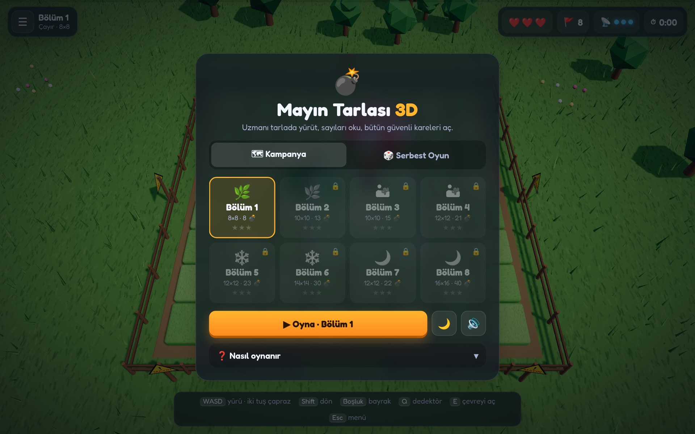
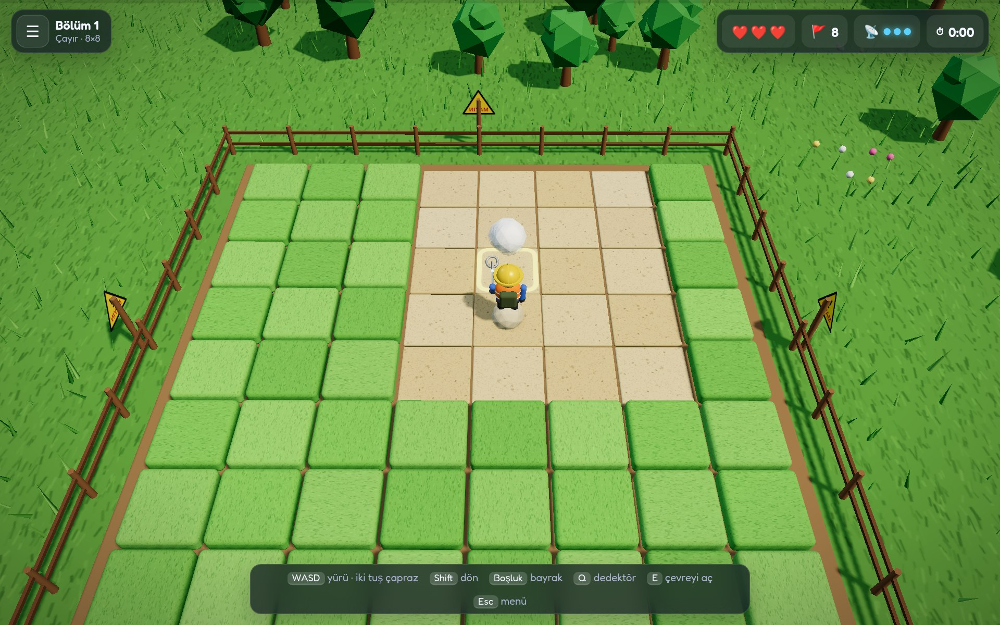

<a href="https://github.com/yigitbuyukeren/mayin-tarlasi-3d">
  
</a>

<div align="center">

**[🎮 Oynanış](#-oynanış)** &nbsp;·&nbsp; **[🗺️ Bölümler](#️-bölümler)** &nbsp;·&nbsp; **[🐞 Sorun bildir](https://github.com/yigitbuyukeren/mayin-tarlasi-3d/issues)**

[](LICENSE)


[](https://github.com/yigitbuyukeren/mayin-tarlasi-3d/actions)

🇹🇷 [Türkçe](#-türkçe) &nbsp;·&nbsp; 🇬🇧 [English](#-english)

</div>

<details open>
<summary><h2>🇹🇷 Türkçe</h2></summary>

Uzmanı tarlada yürüterek oynanan 3D mayın tarlası. Kareleri tıklayarak değil, üzerlerine yürüyerek açarsın. **24 görev, oynayarak eğitim, günlük meydan okuma ve çevrimdışı Android sürümü.**

| 🚶 **Yürüyerek oyna** | 🎯 **Adil tarlalar** | 📱 **Telefon ve masaüstü** | 🔒 **Sunucusuz** |
|:---:|:---:|:---:|:---:|
| Kareyi açmak için üzerine yürü, bayrağı önündeki kareye dik | Mayınlar inişten sonra dizilir; bütün güvenli kareler yürüyerek ulaşılabilir | Dokunmatik yön tuşları, klavye ve fare birlikte çalışır | Sunucu, hesap ve analitik yok; her şey tarayıcında |

### 🚀 Çalıştırma

Yalnız izinli oyun kaynaklarını sunan yerel önizlemeyi başlat:

```bash
python3 tools/serve.py --port 8766
```

`http://localhost:8766/` adresini aç. Aynı ağdan erişim için `--bind 0.0.0.0` ekle;
firewall erişimi ayrıca gerekebilir. Tam çevrimdışı önizleme için önce
`python3 tools/package_android.py package`, sonra sunucuya `--android` ekle.

### 📱 Android uygulaması

Web girişi `index.html`, modüler deneyim kaynakları `web/` altındadır. Android kabuğu `android/`
altında ayrı tutulur; web sürümünün çalışması için Android araçları gerekmez.
Android sürümünde oyun ve sabit sürümlü grafik kütüphanesi uygulamayla paketlenir;
oyun sırasında internet bağlantısı, hesap veya sunucu gerekmez.
Kurulum, SDK sürümleri ve paketleme komutları için [Android rehberi](android/README.md).

İlerleme ve devam eden oyun cihazın yerel uygulama verisinde tutulur. Uygulamanın
verilerini silmek veya uygulamayı kaldırmak kayıtları kaybettirebilir. Bulut kayıt
ve cihazlar arası eşitleme yoktur.

Oyun menüsünden düşük/orta/yüksek grafik kalitesi seçilebilir. Mobilde düşük kalite
varsayılandır; çim yoğunluğu değişimi yeni tarlada tam uygulanır. Dokunmatik yön
tuşuna basılı tutmak yalnız açılmış karelerde yürütür; bilinmeyen kareye girmek
için yeni bir dokunuş gerekir. Varsayılan Temkinli adım, bilinmeyen kare için aynı
yöne üç saniye içinde ikinci dokunuşu ister; Ayarlar'dan kapatılabilir. Kamera iki parmakla veya +/− tuşlarıyla yakınlaştırılır.
Arka plandan dönüşte oyun otomatik başlamaz; menüden devam seçilir. Kayıt son
kararlı oyun durumuna dayanır; ani süreç kapanmasında son hareket kaybolabilir.

**Yayın kapısı:** Kaynak kontrollerinin geçmesi tek başına Play Store'a hazır
olduğu anlamına gelmez. İmzalı yayın paketi hazırlamadan önce gerçek Android
cihazında çevrimdışı ilk açılış, uygulama kapatılıp açıldığında kayıt devamı,
arama/arka plan dönüşü, geri tuşu, küçük ekranlar ve uzun oturumda ısınma/pil
tüketimi doğrulanmalıdır. Grafik bağlamı kaybı ve işletim sisteminin süreci
sonlandırması da cihaz testine dahildir. Bu depodaki push mağazaya yayın yapmaz.

### 🎮 Oynanış

Önce iniş karesini seç: tıkla/dokun ya da oklarla gezdirip **Boşluk**'a bas. Etrafındaki 3×3 alan her zaman güvenlidir; mayınlar ancak inişten sonra dizilir.

| Girdi | Ne yapar |
|---|---|
| **WASD** / **Oklar** / Numpad 7 9 1 3 | Yürü. İki yöne birlikte basınca çapraz gider. Bilinmeyen kareye girmek için ayrıca bas. |
| **Shift + yön** | Yerinde dön (kare açmadan yönünü değiştir). |
| **Boşluk** / **F** | Önündeki kareye bayrak koy veya kaldır. |
| **Q** | Dedektör: önündeki kareyi güvenle tara (3 hak). |
| **E** | Çevreyi aç: bayrak sayısı doğruysa sayının etrafındaki güvenli kareleri açar. |
| **Esc** | Menü / duraklat. |
| **R** · **N** · **M** | Yeniden başla · gece modu · ses. |

- **3 can** var. Mayına basınca bir can gider ve geri savrulursun; tarla bitmez, devam edersin.
- Bütün güvenli kareler açılınca bölüm biter. **Yıldız = kalan can**: hiç mayına basmadan bitirirsen 3 yıldız.
- Kampanyada yıldızlar ve açılan bölümler, serbest oyunda zorluk başına en iyi süre tarayıcının `localStorage` alanında (`mt3d-v1-*`) saklanır.

### 🗺️ Bölümler

Kampanya dört bölgede altışar görev içerir: Keşif Hattı, Fırtına Geçidi, Zirve Yolu
ve Kara Kuşak. İlk sekiz görev eski kayıtlarla uyum için korunmuştur:

| # | Tema | Tarla | Mayın |
|---:|---|---:|---:|
| 1 | 🌿 Çayır | 8×8 | 8 |
| 2 | 🌿 Çayır | 10×10 | 13 |
| 3 | 🌵 Çöl | 10×10 | 15 |
| 4 | 🌵 Çöl | 12×12 | 21 |
| 5 | ❄️ Karlı Tepe | 12×12 | 23 |
| 6 | ❄️ Karlı Tepe | 14×14 | 30 |
| 7 | 🌙 Gece Görevi | 12×12 | 22 |
| 8 | 🌙 Gece Görevi | 16×16 | 40 |

**Serbest oyun:** 🙂 Kolay 9×9 (10 mayın) · 😬 Orta 12×12 (22) · 💀 Zor 16×16 (40). Süre rekorları zorluk başına tutulur.

9–24. görevler 16×16–18×18 tarlalar ve 41–55 mayın içerir. İsimler, hedefler ve tüm
bölüm tanımları [`web/progression.js`](web/progression.js) içindedir. Hasarsız
bitirme, az dedektör kullanma ve süre hedefleri bonus madalya verir; normal
kazanma şartını değiştirmez, sonraki bölüme geçişi engellemez.

### 🧭 Mobil macera

- **Sekiz adımlı eğitim:** iniş, yürüme, sayılar, bayrak, dedektör ve çevre açmayı
  gerçekten oynayarak öğren. Tekrar oynanabilir; kampanyayı atlatmaz.
- **Günlük görev:** UTC gününe bağlı yerel tohum, sabit iniş ve aynı mayınlar.
  İlk zafer 12, ilk hedef madalyası ayrıca 5 oyun altını kazandırır. Cihazın tarihi
  kullanılır; hesap, çevrimiçi sıralama ve sunucu doğrulaması yoktur.
- **Gardırop:** altı renk görünümü, yalnız kazanılan altınla açılır. Gerçek para,
  reklam veya uygulama içi ödeme yoktur.
- **İlerleme:** bölüm rekorları, hedef madalyaları, on başarım ve istatistikler.
  Aynı koşu ikinci kez ödül vermez. Günlük geçmiş 30 gün, koşu defteri 128 sonuçla
  sınırlıdır. Eski yıldızlar ve kilitler korunur; geçmişe dönük altın verilmez.
- **Ayarlar:** solak düzeni, ses, isteğe bağlı titreşim, temkinli adım, azaltılmış
  hareket ve kalite. Titreşim cihaz/WebView desteğine bağlıdır.

### ✨ Neler var

- 🎲 **Adil mayın dizilimi:** iniş karesi ve çevresi boş bırakılır; dizilim, bütün güvenli karelerin yürüyerek erişilebilir olduğu doğrulanana kadar yeniden denenir. Çıkmaz tarla oluşmaz.
- 🏃 **Karakter kontrolü:** yön, çapraz yürüme, yerinde dönme ve mayınla geri savrulma; kamera karakteri izler.
- 🚩 **Bayrak ve çevre açma:** klasik mayın tarlası mantığı, ama bayrağı önündeki kareye dikersin.
- 📡 **Dedektör:** üç hakla önündeki kareyi güvenle tarar.
- 🌗 **Gece modu:** aynı tarlayı gece ışığında oyna; tercih hatırlanır.
- 🔊 **Web Audio sesleri:** adım, bayrak, tarama, patlama ve zafer sesleri tarayıcıda üretilir; ses dosyası yoktur.
- 📱 **Dokunmatik kontroller:** sol altta yön tuş takımı, sağda bayrak, tarama ve çevre açma düğmeleri.
- 🏆 **İlerleme:** bölüm kilitleri, yıldızlar ve en iyi süreler `localStorage` alanında kalır; "İlerlemeyi sıfırla" hepsini siler.
- ⚡ **Framework yok:** çekirdek `index.html`, modüler deneyim kaynakları `web/` altında; Android kaynakları ağsız paketlenir.

### 📸 Ekran görüntüleri

| Menü | Oyun |
|:---:|:---:|
|  |  |

### 🔒 Gizlilik ve teknik yapı

- Sayfa kendi sunucusuna sahip değildir; skor, ilerleme veya oyun verisi hiçbir yere gönderilmez.
- Web sürümünde dışarıdan yalnız sabit **Three.js 0.160.0** ve **Google Fonts** yüklenir; birinci taraf `web/` kaynakları aynı origin'den gelir. Başka dış hedef veya analitik yoktur; CSP `connect-src 'none'` kullanır. Android tüm oyun kaynaklarını içinde taşır; `INTERNET` izni yoktur, yalnız normal `VIBRATE` izni vardır.
- Mayın tarlası, tema, karakter ve arayüz Three.js ile çalışma anında üretilir; görsel dosyası kullanılmaz.
- Oyun durumu yalnız `localStorage` alanındaki `mt3d-v1-*` anahtarlarında tutulur.

### 🛠️ Geliştirme

Değişiklikten sonra sayfayı denetle:

```bash
python3 tools/check.py
```

Kontrol; zorunlu meta etiketlerini ve CSP'yi, benzersiz `id`'leri, izin verilen ağ hedeflerini, sabitlenmiş Three.js sürümünü ve satır içi JavaScript'in sözdizimini (`node --check`) doğrular. Ayrıca kayıt birim testlerini, ağsız Android paketlemeyi ve Android güvenlik kontrollerini çalıştırır. Node gerekir. Aynı kontrol GitHub Actions'ta da çalışır ([`check.yml`](.github/workflows/check.yml)).

Mobil tarayıcı regresyonları için Python Playwright bağımlılığı
`tools/requirements-test.txt` içinde sabitlenmiştir. Ayrı bir sanal ortamda
`python3 -m pip install -r tools/requirements-test.txt` ve
`python3 -m playwright install chromium` ile hazırlanabilir. Bu testler gerçek
Android WebView, işletim sistemi geri tuşu veya fiziksel cihaz performansının
yerine geçmez.

`python3 tools/test_experience.py` gerçek dokunuşlarla eğitimi, günlük tarlayı,
gardırobu, ayarları ve gerçek görev bitişi/tek ödülü sınar. Android emülatör ve
WebView/native test komutları [`android/TESTING.md`](android/TESTING.md) içindedir.
Tarayıcı ve emülatör testleri fiziksel cihazın pil/ısınma testinin yerine geçmez.

### 📜 Lisans

[MIT](LICENSE): kullanabilir, değiştirebilir, dağıtabilirsin. ⭐ Beğendiysen yıldız vermeyi unutma!

</details>

<details>
<summary><h2>🇬🇧 English</h2></summary>

A 3D minesweeper you play by walking across the field rather than clicking tiles. **24 missions, an interactive tutorial, daily challenges, unlockable outfits, and an offline Android app.**

| 🚶 **Walk to play** | 🎯 **Fair fields** | 📱 **Phone and desktop** | 🔒 **No server** |
|:---:|:---:|:---:|:---:|
| Step on a tile to open it, plant a flag on the tile ahead | Mines are placed after landing; every safe tile is reachable on foot | Touch d-pad, keyboard and mouse all work | No server, account or analytics; everything runs in your browser |

### 🚀 Run it

Start the allowlisted game preview server:

```bash
python3 tools/serve.py --port 8766
```

Open `http://localhost:8766/`. Add `--bind 0.0.0.0` for LAN access; firewall rules
may be required. For offline assets, run `python3 tools/package_android.py package`
then add `--android` to the preview command. Only game resources are served.

### 🎮 How to play

First pick a landing tile: click/tap it, or move the cursor with the arrow keys and press **Space**. The surrounding 3×3 area is always safe; mines are only placed after you land.

| Input | Action |
|---|---|
| **WASD** / **Arrows** / Numpad 7 9 1 3 | Walk. Hold two directions to move diagonally. Press again to step onto an unknown tile. |
| **Shift + direction** | Turn in place without opening a tile. |
| **Space** / **F** | Flag or unflag the tile ahead. |
| **Q** | Detector: safely scan the tile ahead (3 charges). |
| **E** | Chord: if the flag count matches, open the safe tiles around a number. |
| **Esc** | Menu / pause. |
| **R** · **N** · **M** | Restart · night mode · sound. |

- You have **3 lives**. Stepping on a mine costs one and knocks you back; the run continues.
- The level ends when every safe tile is open. **Stars = remaining lives**: finish without a hit for 3 stars.
- Campaign stars and unlocked levels, plus best times per free-play difficulty, are stored in the browser's `localStorage` (`mt3d-v1-*`).

### 🗺️ Levels

The campaign has 24 missions in four six-mission regions. The first eight keep
their original settings for save compatibility:

| # | Theme | Field | Mines |
|---:|---|---:|---:|
| 1 | 🌿 Meadow | 8×8 | 8 |
| 2 | 🌿 Meadow | 10×10 | 13 |
| 3 | 🌵 Desert | 10×10 | 15 |
| 4 | 🌵 Desert | 12×12 | 21 |
| 5 | ❄️ Snowy Hill | 12×12 | 23 |
| 6 | ❄️ Snowy Hill | 14×14 | 30 |
| 7 | 🌙 Night Mission | 12×12 | 22 |
| 8 | 🌙 Night Mission | 16×16 | 40 |

**Free play:** 🙂 Easy 9×9 (10 mines) · 😬 Medium 12×12 (22) · 💀 Hard 16×16 (40). Best times are kept per difficulty.

Missions 9–24 use 16×16–18×18 fields with 41–55 mines. The full catalog lives in
`web/progression.js`. Bonus medals reward clean runs, scan limits or target times
without blocking normal progression. An eight-step playable tutorial, deterministic
UTC daily boards, six earned-coin outfits, ten achievements, records, left-handed
controls, cautious double-tap steps, haptics and reduced-motion settings are included.
No real-money payments, ads, accounts or online leaderboards are used.

### ✨ Features

- 🎲 **Fair mine placement:** the landing tile and its neighbours stay clear; layouts are retried until every safe tile is reachable on foot, so no level can be impossible.
- 🏃 **Character control:** direction, diagonal movement, turning in place and mine knockback; the camera follows the character.
- 🚩 **Flags and chording:** classic minesweeper logic, with the flag planted on the tile ahead.
- 📡 **Detector:** three charges to safely scan the tile ahead.
- 🌗 **Night mode:** replay any field in night lighting; the preference is remembered.
- 🔊 **Web Audio sounds:** footsteps, flags, scanning, explosions and victory are generated in the browser; there are no audio files.
- 📱 **Touch controls:** a d-pad on the left, flag, scan and chord buttons on the right.
- 🏆 **Progress:** level locks, stars and best times stay in `localStorage`; "Reset progress" clears them all.
- ⚡ **No framework:** entry point `index.html`, local progression/UI files in `web/`, offline runtime assets bundled in Android.

### 📸 Screenshots

| Menu | Game |
|:---:|:---:|
|  |  |

### 🔒 Privacy and technical notes

- The page has no server; scores, progress and game data are never sent anywhere.
- Only two outside sources are loaded: a pinned **Three.js 0.160.0** (jsdelivr) and **Google Fonts** (Fredoka). There are no other network requests, CDNs or analytics; the CSP in `index.html` sets `connect-src 'none'` to block network connections.
- The field, themes, character and UI are generated at runtime with Three.js; no image assets are used.
- Game state lives only in `localStorage` keys starting with `mt3d-v1-`.

### 🛠️ Development

Check the page after a change:

```bash
python3 tools/check.py
```

The check verifies required meta tags and the CSP, unique `id`s, allowed network targets, the pinned Three.js version and the syntax of inline JavaScript (`node --check`). It needs Node. The same check runs in GitHub Actions ([`check.yml`](.github/workflows/check.yml)).

Run `python3 tools/test_experience.py` for tutorial, daily seed, wardrobe, settings
and win/reward regressions. See `android/TESTING.md` for isolated Android emulator
tests. Physical-device performance, battery and long-session tests remain necessary.

### 📜 License

Released under the [MIT License](LICENSE): you may use, modify and distribute it. ⭐ If you like it, give it a star!

</details>
